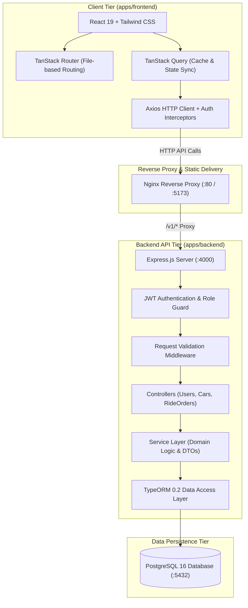
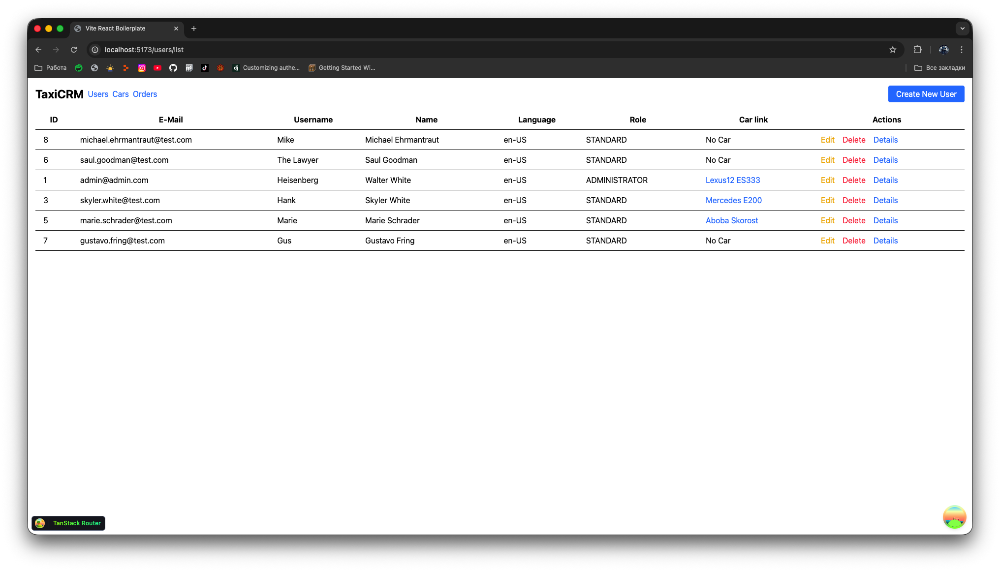
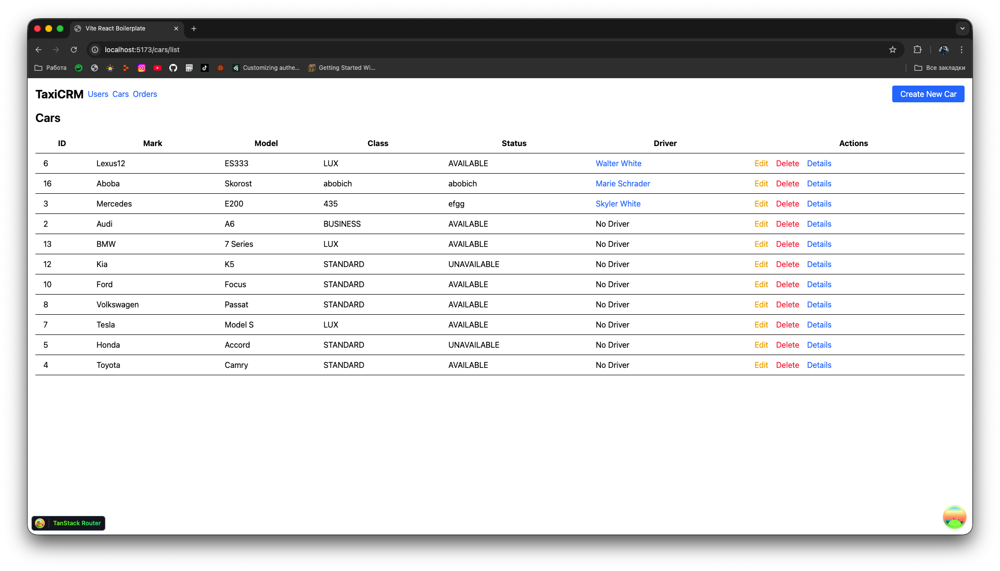
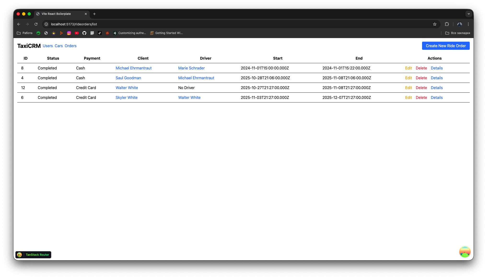
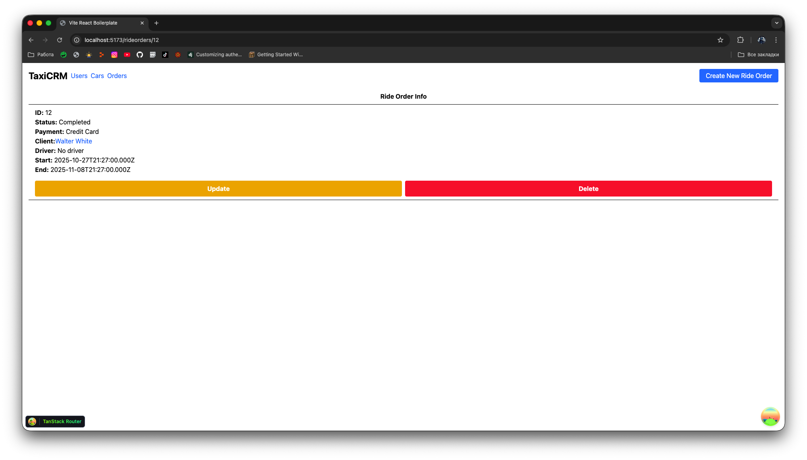

# Taxi CRM — Fleet & Ride Order Management Platform

[](https://github.com/MarryBye/easy-crm/actions/workflows/ci.yml)
[](https://www.typescriptlang.org/)
[](https://turbo.build/)
[](https://react.dev/)
[](https://vitejs.dev/)
[](https://expressjs.com/)
[](https://typeorm.io/)
[](https://www.postgresql.org/)
[](https://www.docker.com/)

A full-stack operational CRM platform designed for taxi fleet dispatchers, fleet operators, and administrative staff to manage vehicle fleets, driver assignments, and ride order lifecycles in real time. 

Architected as a unified, production-ready TypeScript monorepo using **pnpm workspaces** and **Turborepo**, this project features a React 19 web client powered by the TanStack suite, a layered Express + TypeORM REST API, automated database migrations and seeds, and multi-stage Docker containerization.

---

## Architecture Overview



---

## Core Features

- **Fleet Asset Management:** Catalog and track vehicle inventories, specifications (mark, model, year), service classes (`STANDARD`, `BUSINESS`, `LUX`), and operational statuses (`AVAILABLE`, `UNAVAILABLE`).
- **Driver & User Directory:** Comprehensive user administration with role-based permissions (`ADMINISTRATOR`, `STANDARD`), personal profile management, and driver-to-car binding.
- **Ride Order Lifecycle Tracking:** Complete dispatch management supporting trip origination, completion timestamps, client assignment, driver allocation, and payment categorization (`CASH`, `CARD`).
- **Layered Backend Architecture:** Strict separation of concerns (Middleware &rarr; Controller &rarr; Service &rarr; Entity) with strongly typed DTOs and centralized error handling.
- **Modern React Frontend Stack:** Client-side architecture leveraging React 19, TanStack Router for type-safe routing, TanStack Query for cache invalidation, and TanStack Table for data grid rendering.
- **Component Design System & Testing:** Isolated UI development via Storybook 8, component testing with Vitest and React Testing Library, and end-to-end regression testing with Playwright.
- **Automated Seeding & Migrations:** Out-of-the-box database initialization creating schemas, relationships, sample fleets, drivers, and admin credentials.

---

## User Interface

| Users Management | Fleet Catalog |
| :---: | :---: |
|  |  |

| Ride Orders Lifecycle | Order Details & Status |
| :---: | :---: |
|  |  |

---

## Repository Structure

```
easy-crm/
├── .github/
│   └── workflows/
│       └── ci.yml               # GitHub Actions CI workflow (Node 22, pnpm, lint, check-types, build)
├── apps/
│   ├── backend/                 # Express + TypeORM + PostgreSQL API
│   │   ├── src/
│   │   │   ├── controllers/     # Route handlers (auth, users, cars, rideorders)
│   │   │   ├── dto/             # Data Transfer Objects (UserResponseDTO, etc.)
│   │   │   ├── middleware/      # Auth, role check, validation, error handler
│   │   │   ├── orm/             # Entities, migrations, seed scripts, configs
│   │   │   ├── routes/          # Express route definitions
│   │   │   ├── service/         # Domain services (UserService, CarService, etc.)
│   │   │   └── utils/           # Response formatters and custom errors
│   │   ├── Dockerfile           # Multi-stage production container build
│   │   ├── docker-entrypoint.sh # Database wait, migration, and seed runner
│   │   └── package.json
│   │
│   └── frontend/                # React 19 + Vite + TanStack Client
│       ├── src/
│       │   ├── features/        # Feature queries and mutations (auth, cars, orders, users)
│       │   ├── routes/          # TanStack Router file routes ($carId, $userId, etc.)
│       │   ├── store/           # Zustand client auth store with persistence
│       │   └── lib/             # Axios client with bearer token interceptor
│       ├── .storybook/          # Storybook 8 configuration
│       ├── e2e/                 # Playwright end-to-end tests
│       ├── Dockerfile           # Multi-stage Vite build -> Nginx runtime
│       ├── nginx.conf           # Static server configuration and API reverse proxy
│       └── package.json
│
├── docs/
│   └── screenshots/             # Application screenshots and visual verification
├── docker-compose.yml           # Root orchestration (postgres, backend, frontend)
├── pnpm-workspace.yaml          # pnpm monorepo workspace definition
├── turbo.json                   # Turborepo task pipeline orchestration
├── package.json                 # Monorepo root scripts
└── README.md
```

---

## Quickstart Guide

### Option 1: One-Command Startup with Docker Compose (Recommended)

Ensure Docker and Docker Compose are installed and running on your system:

```bash
# Clone the repository
git clone https://github.com/MarryBye/easy-crm.git
cd easy-crm

# Build and start all services (PostgreSQL, Backend API, Frontend Nginx)
docker compose up --build
```

Once initialized, the services will be accessible at:
- **Frontend Portal:** [http://localhost:5173](http://localhost:5173) (or [http://localhost](http://localhost))
- **Backend API:** [http://localhost:4000/v1](http://localhost:4000/v1)
- **Database:** `localhost:5432` (`taxi_crm`)

#### Pre-seeded Demo Accounts

| Role | Email | Password |
| :--- | :--- | :--- |
| **Administrator** | `admin@admin.com` | `pass1` |
| **Standard User** | `standard@standard.com` | `pass1` |

---

### Option 2: Local Development with Turborepo

#### Prerequisites
- **Node.js** >= 20.x (Recommended: Node 22)
- **pnpm** >= 10.x (Tested on `pnpm@12.10.1`)
- **PostgreSQL** 16 instance running locally or via Docker

#### 1. Setup Environment Variables

```bash
cp .env.example .env
cp apps/backend/.env.example apps/backend/.env
cp apps/frontend/.env.example apps/frontend/.env
```

#### 2. Install Dependencies

```bash
pnpm install
```

#### 3. Run Database Migrations & Seeds

```bash
# Run migrations
pnpm --filter @taxi-crm/backend run migration:run:dev

# Seed initial users, cars, and ride orders
pnpm --filter @taxi-crm/backend run seed:run:dev
```

#### 4. Launch Development Servers

```bash
# Start both backend and frontend concurrently with Turborepo
pnpm dev

# Or run individual applications
pnpm dev:backend
pnpm dev:frontend
```

---

## Monorepo Command Reference

All workspace tasks are coordinated through **Turborepo** from the monorepo root:

| Command | Action |
| :--- | :--- |
| `pnpm dev` | Starts development watchers for all apps concurrently |
| `pnpm build` | Compiles backend TypeScript and builds frontend Vite bundles |
| `pnpm check-types` | Executes `tsc --noEmit` across all workspace packages |
| `pnpm lint` | Runs ESLint across backend and frontend codebases |
| `pnpm lint:fix` | Automatically fixes code style and formatting issues |
| `pnpm test` | Runs unit tests (Vitest in frontend, Mocha in backend) |
| `pnpm docker:build` | Rebuilds and launches Docker containers in detached mode |
| `pnpm docker:down` | Stops and tears down active Docker containers |
| `pnpm docker:logs` | Streams live container logs |

---

## API Specification Summary

All API endpoints are prefixed with `/v1`.

### Authentication
- `POST /v1/auth/login` — Authenticates credentials and issues JWT token.
- `POST /v1/auth/register` — Registers a new user account.
- `POST /v1/auth/change-password` — Updates password for the authenticated user (`Bearer` token required).

### Users (Administrator)
- `GET /v1/users` — Paginated list of registered users.
- `POST /v1/users` — Creates a new user with designated role.
- `GET /v1/users/:id` — Retrieves comprehensive user profile including assigned vehicle.
- `PATCH /v1/users/:id` — Updates user information.
- `DELETE /v1/users/:id` — Removes user record.

### Vehicle Fleet (Administrator)
- `GET /v1/cars` — List of fleet vehicles and driver associations.
- `POST /v1/cars` — Registers a new vehicle into the fleet.
- `GET /v1/cars/:id` — Vehicle specifications, service class, and driver details.
- `PATCH /v1/cars/:id` — Updates vehicle status, class, or assigned driver.
- `DELETE /v1/cars/:id` — Removes vehicle from fleet catalog.

### Ride Orders (Administrator)
- `GET /v1/rideorders` — List of all ride orders including joined client and driver DTOs.
- `POST /v1/rideorders` — Dispatches a new ride order.
- `GET /v1/rideorders/:id` — Detailed ride order breakdown.
- `PATCH /v1/rideorders/:id` — Modifies trip status, payment method, or timing.
- `DELETE /v1/rideorders/:id` — Deletes ride order record.

---

## License

This project is licensed under the [MIT License](LICENSE).
